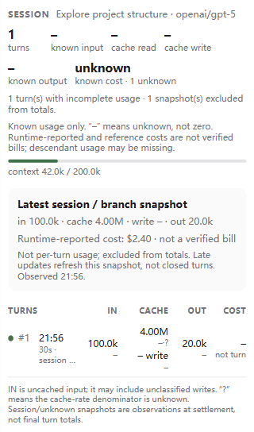
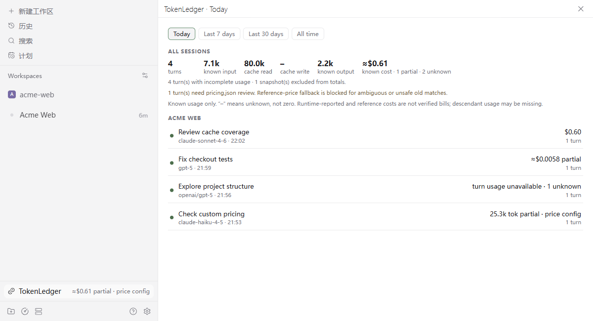

# TokenLedger

Per-turn LLM token usage and cost for [Paseo](https://paseo.sh) agents — an agent panel that records what each turn consumed, keeps a local history, and estimates cost when upstream omits it.

一个为 Paseo 提供**按轮（agent turn）**统计 token 用量的插件：面板实时显示进行中一轮的状态，每轮结束后固化一条账目，历史保存在本机。

<p align="center">
  <a href="https://github.com/stv1024/token-ledger/releases/download/v0.6.0/token-ledger-promo.mp4">
    
  </a>
  <br>
  <sub>▶ 20-second promo · <a href="promo/">source</a></sub>
</p>

<p align="center">
  
</p>

## What it shows

**Per-agent panel** (workspace/explorer, bound to one session — the header names the agent and model it is tracking):

- **Session summary** — known per-turn input / cache / output subtotals and runtime-reported or reference cost. Missing counts stay `–`; partial estimates and unknown-cost turns are counted explicitly.
- **Turn in progress** — elapsed time, observed token counts and cost when attributable to the turn, plus a context-window bar. Idle context usage remains visible.
- **Turn history** — one row per finished turn with accounting scope and coverage. OMP session/branch totals and unverified-harness observations are snapshots, not turn usage, and are excluded from totals. A separate latest-snapshot card also reflects late idle updates.

**Composer pill** — shows attributable current-turn totals when available. For OMP, `Session ≈4.12M tok` means the known tokens in the latest session/branch snapshot, not a per-turn total; `≈` marks missing components. Unknown-scope snapshots are named without summing potentially overlapping counts. No data shows **Waiting for usage** while running or **No usage reported** when idle. Reference estimates, partial costs and pricing configuration warnings remain explicit. Pressing the pill opens that agent's panel.

<p align="center">
  
</p>

**Sidebar** — a **TokenLedger** row in the sidebar footer shows today's cost (or tokens when no price is known), with an activity icon while a turn is running. "Today" starts at local midnight on the device that shows it.

**Overview** (sidebar footer → TokenLedger, or the command center) — all sessions in one place: grand totals, then per-agent rows grouped by workspace with live-turn indicator, last activity, cost/tokens, and turn count. Pick **Today**, **Last 7 days**, **Last 30 days**, or **All time**. The sidebar row opens it on Today; the command center opens All time. Switching ranges stays on the same screen. A range lists agents with turns that ended in it, plus agents with a turn in flight. Tapping a row jumps to that agent.

<p align="center">
  
</p>

**Timeline** — each newly finished turn gets one passive usage summary after its ledger record is saved. Older cards without scope metadata say **legacy scope metadata unavailable**; they do not claim exclusion from totals. The ledger remains authoritative. No polling or message replacement is involved.

## Compatibility

TokenLedger **v0.8.1** requires **Paseo 0.11.0 or newer**, on both the daemon and the app, without an upper version limit. It uses the screen and sidebar footer APIs that Paseo 0.11 added. The verified hosts are **0.11.1** and **0.12.0**, including agents in Paseo 0.12 background workspaces; allowing newer versions is not a claim that every future release has been tested. SDK development dependencies are pinned to 0.11.1, with CI checks against the minimum, the pin, 0.12.0, and the latest published SDK. See the [compatibility policy and verification notes](docs/compatibility.md).

Paseo 0.9.1–0.10.x users should stay on `v0.6.3`; Paseo 0.8 users on `v0.5.1`; Paseo 0.7 users on `v0.3.1`. Existing `ledger.jsonl` records remain readable; no migration or deletion is required. See the [v0.6.0 release notes](docs/releases/v0.6.0.md) for the 0.9.1 migration details.

The v0.8.0 accounting fixes were also exercised on Paseo 0.11.2. After updating, reload/reopen the client so it uses the new nullable summary fields, scope metadata and pricing warnings. Existing JSONL records are reinterpreted on read, not rewritten. The screenshots above use synthetic data on an isolated host.

## Install

Install from the [Paseo plugin registry](https://paseo.sh/plugins/stv1024/token-ledger) (Paseo 0.11.0 or newer):

```bash
paseo plugin add stv1024/token-ledger
```

The registry installs the version its maintainers last reviewed, so a new release reaches it after review. To get the latest npm release directly:

```bash
paseo plugin install npm:paseo-token-ledger
```

Or paste either source into **Settings → Plugins → Plugin source**.

To install a tagged release from GitHub instead:

```bash
paseo plugin add github:stv1024/token-ledger --ref v0.8.1
```

Since Paseo 0.11, a bare `owner/name` source means the official plugin registry, which rejects `--ref`. Keep the `github:` prefix for Git installs. On Paseo 0.9.1–0.10.x, use `paseo plugin add stv1024/token-ledger --ref v0.6.3`.

Inspect or apply updates with:

```bash
paseo plugin update token-ledger --check
paseo plugin update token-ledger
```

Registry installations update to the registry's current reviewed version. npm installations update to the latest npm release. Git install selectors do not pin future updates: without an explicit `--ref`, Git updates follow the remote's default branch. Existing GitHub installations can keep updating from Git; switching to npm means `paseo plugin remove token-ledger` followed by the npm install (ledger data in `~/.paseo/plugins/token-ledger/` is kept). Local development installations use `paseo plugin reload token-ledger` after source changes.

Update both the daemon and app to a compatible Paseo version before updating the plugin. Check `paseo plugin ls` afterward; TokenLedger should be `running`. Reopen the desktop app if an existing window still shows an older plugin UI.

Plugins must be enabled on the daemon (Settings → Plugins, or `pluginsEnabled: true` in `~/.paseo/config.json` followed by `paseo reload`). Plugins are trusted, unsandboxed code — read the source before installing, including this one.

Open any agent and pick the **TokenLedger** panel. Server lifecycle hooks start tracking when an interactive provider session opens or a turn starts, including CLI use without an app connected. Connecting an app also attaches the tracker to existing sessions.

## Settings

Open the gear on the overview, the **Open TokenLedger Settings** command, or **Settings → Plugins → token-ledger → TokenLedger** on the selected host:

- **Timeline summaries** controls summaries for newly finished turns; existing rows remain intact.
- **OpenRouter reference prices** controls both cached reference prices and background catalog refresh.
- **Built-in fallback prices** controls estimates when neither custom nor enabled OpenRouter pricing matches.
- **Custom prices override reported costs** (off by default) uses a matching `pricing.json` price instead of the runtime-reported cost, for example for local models that a runtime prices at a list-price fallback. Add `providers` to an entry to limit it to one provider. OpenRouter and built-in prices never replace a reported cost. The reported value stays in the ledger file, so turning the option off restores it.
- **Refresh frequency** selects normal (3 seconds active / 30 seconds idle) or relaxed (10 / 60 seconds) fallback polling. Live updates still trigger refreshes.

Settings apply without a plugin reload and are shared by clients of that host. By default, reported costs and `pricing.json` overrides retain priority. These preferences do not alter ledger retention or erase history.

The other three switches default to on, and refresh frequency defaults to normal.

## How turns are measured

A "turn" is one user message through to `turn_completed`, `turn_failed`, or `turn_canceled` — potentially spanning many model calls. Token counts always come from the provider; TokenLedger never invents missing usage:

| Situation | Value used | Accounting scope |
| --- | --- | --- |
| Whole-turn terminal aggregate (Claude) | reported counts | turn; coverage can still be incomplete |
| Per-request observations (Codex) | observed requests summed | turn; approximate without stable request IDs |
| Current-session/branch aggregate (OMP) | latest reported snapshot | session; excluded from per-turn totals and prices |
| Unverified harness | latest reported snapshot | unknown; excluded from per-turn totals and prices |
| Nothing reported | unknown, not zero | unavailable |

Counting conventions are selected by verified harness/provider identity, never by the model name. A custom provider that declares `extends: "claude"` or `extends: "codex"` in the daemon config follows its base harness; new records store the resolved harness. OMP input is already exclusive of cache; Codex input is inclusive. “IN” is uncached input after subtracting cache reads and known writes; if writes are omitted, Codex IN may still include unclassified writes. Unknown provider values stay as reported, without guessed normalization.

For attributable turn costs, the order is runtime-reported cost, local override, OpenRouter reference, then built-in fallback; **Custom prices override reported costs** puts a matching local override first. Claude session-cost deltas use the known baseline; a lower counter alone does not prove a session reset. A runtime's reported cost can itself be an estimate: it is not a verified invoice, and custom pricing replaces it only when **Custom prices override reported costs** is on. Residuals do not identify missing tokens or billing categories.

Estimated costs are marked `≈`; missing components/rates or uncertain request coverage add `partial`. Summaries expose unknown-cost turns rather than presenting the known subtotal as a complete bill. Codex request observations are priced separately; legacy records without requests use the aggregate as an explicitly partial estimate. A tiered price cannot be selected when the complete prompt size is unknown. Per-request routed model identities are not exposed, so reference pricing uses the recorded selected model, not a claim of the actual billed model.

Paseo 0.11.2 still omits cache-write counts from the public Claude, Codex and OMP usage paths. Missing counts remain unknown; setting a price cannot recover them. Cache hit rate is read tokens divided by the complete prompt size: Codex's inclusive input supplies that denominator, while Claude/OMP need input + read + write. Without a complete denominator the panel shows `?`, not a near-100% rate. If input/cache counts are inconsistent, the plugin does not clamp them into a fabricated zero.

Provider-internal subagents are not ordinary Paseo catalog agents. The Codex adapter discards child usage notifications; OMP session stats already include some task-child usage. Neither just traversing the catalog nor blindly adding children fixes accounting. OMP's branch-view totals can decrease, and its final usage can arrive after completion or be superseded by the next turn. Without epochs and turn attribution the plugin does not invent per-turn deltas: cumulative history is shown as snapshots and late observations refresh the separate latest-snapshot card. These snapshots do not enter date-range totals. TokenLedger uses only public Paseo APIs, not provider logs or gateway billing endpoints. See the [upstream API requirements](docs/paseo-usage-api.md).

Identical consecutive usage snapshots cannot be distinguished from separate equal-size model calls, so Codex totals remain `partial`. Open-turn observations, session identity and billing baselines are checkpointed locally, and graceful plugin reloads preserve them. A crash can lose observations since the last checkpoint; events missed while the plugin was offline cannot be reconstructed. Interrupted recovered turns are marked as partial/unavailable rather than claiming an exact offline outcome. `exact` describes the reported turn aggregate, not proof that every descendant or billing category was included.

When observed, the provider session ID is retained to distinguish billing resets from resumes. This optional field is compatible with existing v1 records.

After a subscription error or reconnect, the tracker refreshes the affected agent and reconciles complete catalog snapshots. Affected turns retain `usageGap: true` and are shown with `gap`; a missed terminal outcome uses `status: "unknown"`. A cumulative cost spanning the gap is kept raw but is not assigned to one turn. Subsequent known billing baselines resume normal deltas. Recovery never invents missing requests or appends historical summaries to the Timeline.

### Pricing overrides

On first use, TokenLedger creates an **empty** `~/.paseo/plugins/token-ledger/pricing.json` (or under `PASEO_HOME`). No internal gateway prices or currency conversion are shipped. Existing files are preserved. Overrides are USD per million tokens and have highest priority among estimates. Provider substring scopes match only the provider, not the model string. Full model IDs are matched case-insensitively, with one safe spelling equivalence: standard Claude numeric versions such as `claude-opus-5.5` and `claude-opus-5-5` match each other. Namespaces, context/mode suffixes, arbitrary model punctuation and model arrays are not collapsed. Add explicit `aliases` for other verified identities. Scoped matches take priority over global ones; ambiguous matches are unpriced. Valid edits take effect after the next 30-second recheck, or a reload:

```json
{
  "version": 1,
  "currency": "USD",
  "prices": [
    {
      "providers": ["my-provider"],
      "model": "my-model",
      "aliases": ["my-provider/my-model"],
      "tiers": [
        { "input": 1.5, "cacheRead": 0.15, "cacheWrite": 1.875, "output": 6 }
      ]
    }
  ]
}
```

**Upgrading old custom prices:** if a model would only have matched through the old namespace/context/provider folding, TokenLedger blocks OpenRouter/built-in fallback and shows **price config**. Review that model's full ID and provider scope, then add a verified alias or correct the entry; the warning clears after the valid configuration is re-read. The plugin does not edit your file or silently replace an intended override with a reference rate. Runtime-reported costs remain visible, but their reference breakdown can still require review.

`cacheRead` and `cacheWrite` are optional independent USD/MTok rates. Missing rates are unknown; an explicit zero is free. A measured zero token count costs zero even when its rate is unknown. Missing rates no longer fall back to ordinary-input pricing. The example's write multiplier is illustrative, not universal. Tiers use the full prompt count when available. Runtime-reported totals are never increased by adding the estimated components again.

OpenRouter's public model catalog, including `input_cache_write` when provided, is cached locally for 24 hours in `openrouter-pricing.json`. Local/cache prices are served before network refresh completes. If refresh fails, the last cache remains active, with retries no more often than every five minutes while the plugin is in use.

Built-in Claude rates were checked against [Anthropic's pricing table](https://platform.claude.com/docs/en/about-claude/pricing) on 2026-09-23. Opus 5.5 standard rates are input $4, cache read $0.20, output $20 per million tokens; the cache-write reference is $5 for the 5-minute lifetime. Other lifetimes, Fast Mode, discounts and gateway contracts can differ. The public usage API does not identify cache lifetimes or the billed service tier. Unknown model versions and explicit Fast/Batch suffixes do not receive a guessed built-in price. Configure a matching override when needed; private contract prices are never assumed.

## Data & privacy

- Records only usage metadata: timestamps, agent ID, provider, model, token counts, cost, status, duration, quality. **Never** prompts, responses, tool arguments, file paths, or credentials.
- `tracker-state.json` is a separate atomic checkpoint containing open-turn observations and pending ledger writes. Stable IDs make recovery appends idempotent.
- Timeline summaries are a view of newly settled turns, not the authoritative history: Paseo keeps plugin timeline entries in daemon memory. No old entries are backfilled on restart, because appending would place them at the end and change activity ordering.
- Stored locally as JSON Lines at `~/.paseo/plugins/token-ledger/ledger.jsonl` (respects `PASEO_HOME`).
- Retention: the most recent 2,000 turns; older records are trimmed with an atomic rewrite.
- When OpenRouter reference prices are enabled, the plugin reads the public model-price catalog and caches it for 24 hours. No usage data is sent. History does not sync between machines.

## Limitations

- Paseo 0.11.2 omits cache-write counts on current Claude/Codex/OMP usage paths. Missing writes are unknown, and may make the cache-rate denominator unavailable. A reported-cost residual is not proof of missing token charges.
- Child coverage differs by harness: Codex child usage can be omitted, while OMP already includes some child usage. Blindly adding children can double-count.
- OMP session/branch snapshots have no reliable per-turn boundary. They stay separate from per-turn and date-range sums; unknown providers are not priced by guessing semantics from model names.
- Codex request observations and reference estimates remain partial. Runtime-reported costs are not verified invoices.
- Events missed offline cannot be reconstructed; affected turns retain gap/unknown status. Mobile-device testing is more limited than desktop/web verification.

## Support matrix

| Provider | Tokens | Cost |
| --- | --- | --- |
| Claude / claude-* variants | per-turn terminal aggregate; missing categories stay incomplete | runtime-reported when attributable; reference fallback |
| Codex / codex-* variants | summed request observations (`partial`) | partial reference estimate with known prices |
| OMP / omp-* variants | latest session/branch snapshot, excluded from turn totals | raw session cost displayed separately; no guessed turn cost |
| Other providers (OpenCode, Pi, ACP harnesses) | latest unknown-scope snapshot; no guessed aggregation | raw cost retained separately; no turn estimate |

## Development

```bash
git clone https://github.com/stv1024/token-ledger
cd token-ledger
npm install
paseo plugin install /absolute/path/to/token-ledger
npm run typecheck
npm test                      # node --test, no extra deps
paseo plugin reload token-ledger
paseo plugin logs token-ledger
```

Layout: `paseo-plugin.json` declares the registry name, icon, and screenshots, and `OVERVIEW.md` is the registry listing page (no install commands; the registry rejects them). `index.client.tsx` registers the UI; `index.server.ts` registers RPCs and lifecycle hooks. `client/` contains the panel, native button-descriptor pill, overview screen, sidebar footer row, and shared UI. Shipped code takes Paseo client types only from the host SDK (`client/paseo-types.ts`, `server/paseo-types.ts`), so Git and npm installs need no dependencies. `server/turns.ts` is the tested turn state machine, `server/tracker.ts` owns subscriptions and RPCs, `server/store.ts` serializes JSONL writes, and `server/pricing.ts` resolves prices. `shared/` contains RPC contracts, aggregation, pagination, and usage semantics.

## License

MIT
